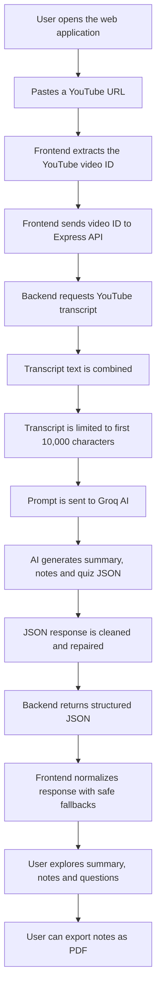
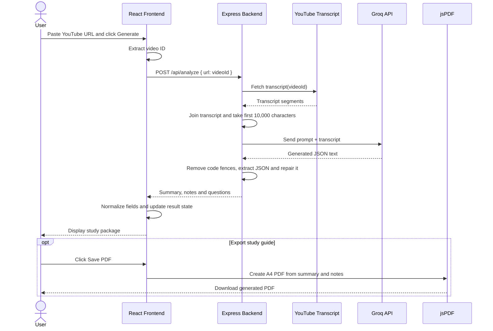
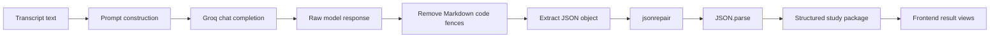
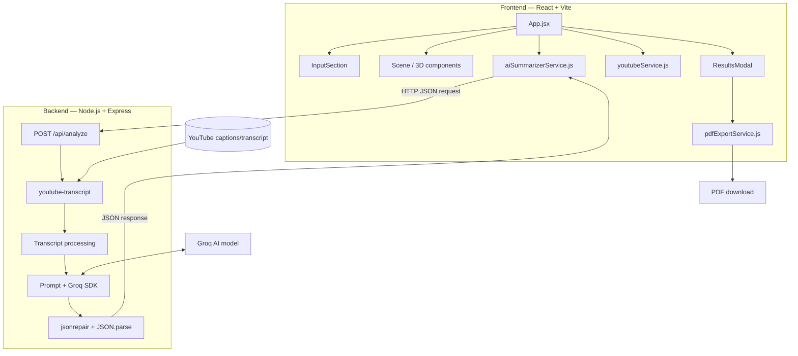

<div align="center">

# 🎬 YouTube AI Study Companion

### Turn YouTube videos into structured summaries, detailed study notes, and knowledge-check questions.

A 3D, cyber-themed learning interface powered by YouTube transcripts and Groq-hosted AI.

[](https://react.dev/)
[](https://vite.dev/)
[](https://threejs.org/)
[](https://nodejs.org/)
[](https://groq.com/)

</div>

---

## 📌 Overview

**YouTube AI Study Companion** is a web application that converts the transcript of a YouTube video into a learning package. Instead of relying only on a short summary, the application asks an AI model to produce:

- An executive-style **TL;DR summary**
- **Key takeaways** from the video
- **Detailed, topic-wise study notes**
- **Multiple-choice questions** for knowledge retention
- A downloadable **PDF study guide**

The interface presents these features inside an interactive 3D environment. Users can paste a YouTube link, generate the study package, explore the results, and export the notes.

> **Current implementation note:** Video metadata displayed by the frontend is currently mock metadata. The backend fetches the video's transcript and uses it for AI analysis. The backend currently processes up to the first 10,000 characters of the transcript.

## ✨ Features

| Feature | Description |
|---|---|
| YouTube link input | Accepts supported YouTube watch, short, embed, live, and Shorts URL formats, as well as an 11-character video ID. |
| Transcript extraction | Retrieves transcript text using `youtube-transcript`. |
| AI-powered study package | Sends transcript text to the Groq API using the configured model. |
| TL;DR summary | Produces a concise overview of the video's central message. |
| Key takeaways | Extracts important ideas and explanations. |
| Detailed notes | Organizes the generated notes into topic-based sections. |
| Knowledge-check quiz | Displays generated multiple-choice questions and lets users select options. |
| PDF export | Creates an A4 PDF study guide containing the summary and notes. |
| 3D learning interface | Uses React Three Fiber and Three.js for a holographic, interactive environment. |
| Responsive result navigation | Switches between Summary, Notes & PDF, and Quiz views. |

## 🖥️ Application Experience

The main interface is built around a 3D scene with three interactive stations:

1. **Summary** — review the TL;DR and key takeaways.
2. **Notes & PDF** — read structured notes and export the study guide.
3. **Questions** — view AI-generated multiple-choice questions and select answers.

The project includes a `src/assets/hero.png` image asset. Add an updated application screenshot here when you have one:

```md

```

---

## 🧠 How It Works

The application follows a frontend-backend-AI workflow.



### Detailed request sequence



### AI generation pipeline



---

## 🏗️ Architecture



### Main technologies

| Layer | Technology | Role |
|---|---|---|
| Frontend | React 19 | Component-based user interface and state management |
| Development/build | Vite | Local development server and production build |
| Styling | Tailwind CSS, CSS | Utility styling and custom visual effects |
| 3D rendering | Three.js | 3D graphics |
| React 3D integration | React Three Fiber | Declarative Three.js scene in React |
| 3D helpers | @react-three/drei | Helpers such as stars and orbit controls |
| Icons | lucide-react | Interface icons |
| Backend | Node.js, Express 5 | HTTP API and server-side processing |
| Transcript extraction | youtube-transcript | Fetches YouTube transcript segments |
| AI integration | groq-sdk | Sends transcript and prompt to Groq |
| AI model | `openai/gpt-oss-20b` | Generates the structured study package in the current backend configuration |
| JSON recovery | jsonrepair | Attempts to repair malformed model-generated JSON |
| PDF generation | jsPDF | Creates downloadable A4 study guide |
| UI feedback | canvas-confetti | Celebration animation after PDF export / quiz submission |

---

## 📂 Project Structure

The repository contains the application inside the `yt/` directory.

```text
Youtube-Summarizer/
│
├── package.json                 # Root-level development dependencies
│
└── yt/
    ├── index.html
    ├── package.json             # Frontend dependencies and scripts
    ├── vite.config.js
    ├── tailwind.config.js
    │
    ├── backend/
    │   ├── package.json         # Backend dependencies
    │   ├── server.js            # Express API and AI analysis endpoint
    │   └── check.js             # Utility to list available Groq models
    │
    └── src/
        ├── App.jsx              # Main application and state orchestration
        ├── main.jsx             # React entry point
        ├── App.css
        ├── index.css
        │
        ├── assets/
        │   ├── hero.png
        │   ├── react.svg
        │   └── vite.svg
        │
        ├── components/
        │   ├── 3d/
        │   │   ├── Scene.jsx
        │   │   ├── CyberFloor.jsx
        │   │   ├── HologramScreen.jsx
        │   │   └── StationPillar.jsx
        │   │
        │   └── ui/
        │       ├── HeaderBar.jsx
        │       ├── InputSection.jsx
        │       └── ResultsModal.jsx
        │
        └── services/
            ├── youtubeService.js
            ├── aiSummarizerService.js
            └── pdfExportService.js
```

---

## ⚙️ Getting Started

### Prerequisites

Install the following before running the project:

- [Node.js](https://nodejs.org/) (a current LTS release is recommended)
- npm (included with Node.js)
- A [Groq API key](https://console.groq.com/keys)

### 1. Clone the repository

```bash
git clone https://github.com/Rishabh-022/Youtube-Summarizer.git
cd Youtube-Summarizer
```

### 2. Install frontend dependencies

```bash
cd yt
npm install
```

### 3. Install backend dependencies

Open another terminal from the repository root:

```bash
cd yt/backend
npm install
```

### 4. Configure the API key

Create a `.env` file inside `yt/backend/`:

```env
GROQ_API_KEY=your_groq_api_key_here
PORT=5000
```

Keep your API key private. Do not commit `.env` to GitHub.

### 5. Start the backend

From `yt/backend/`:

```bash
node server.js
```

The backend listens on:

```text
http://localhost:5000
```

### 6. Start the frontend

In a separate terminal, from `yt/`:

```bash
npm run dev
```

Open the local URL printed by Vite in your browser (typically `http://localhost:5173`).

### 7. Create a production build

From `yt/`:

```bash
npm run build
```

To preview the production build locally:

```bash
npm run preview
```

---

## 🔌 Backend API

### Analyze a YouTube video

**Endpoint**

```http
POST /api/analyze
```

**Request body**

```json
{
  "url": "VIDEO_ID"
}
```

The frontend sends the extracted YouTube video ID in the `url` field.

**Successful response shape**

```json
{
  "videoTitle": "Analyzed Video",
  "channelName": "YouTube",
  "generatedAt": "date",
  "summary": {
    "tl_dr": "A paragraph summarizing the video.",
    "keyTakeaways": [
      "First key takeaway",
      "Second key takeaway"
    ],
    "timeStamps": [
      {
        "time": "00:00",
        "label": "Start"
      }
    ]
  },
  "notes": {
    "sections": [
      {
        "heading": "Topic heading",
        "content": "Detailed notes for this topic."
      }
    ]
  },
  "questions": [
    {
      "id": 1,
      "question": "Question text",
      "options": [
        "Option A",
        "Option B",
        "Option C",
        "Option D"
      ],
      "correctIndex": 0,
      "explanation": "Explanation of the correct option."
    }
  ]
}
```

The exact content and number of generated takeaways, note sections, and questions are determined by the AI response.

**Error response**

```json
{
  "error": "Failed to process video. Please try again."
}
```

The API returns HTTP `400` when the request does not contain a `url`, and HTTP `500` when transcript retrieval or AI processing fails.

---

## 🧩 Important Implementation Details

### YouTube URL handling

The frontend's `extractYouTubeId()` helper supports these URL patterns:

- `youtube.com/watch?v=VIDEO_ID`
- `youtu.be/VIDEO_ID`
- `youtube.com/embed/VIDEO_ID`
- `youtube.com/v/VIDEO_ID`
- `youtube.com/live/VIDEO_ID`
- `youtube.com/shorts/VIDEO_ID`

It also accepts a raw 11-character YouTube video ID.

### Transcript processing

The backend:

1. Calls `YoutubeTranscript.fetchTranscript(videoId)`.
2. Joins transcript segment text into one string.
3. Keeps the first **10,000 characters**.
4. Adds the transcript to the AI prompt.

Transcript availability depends on the video and YouTube's accessibility. Videos without an accessible transcript may fail to process.

### AI prompt and structured output

The backend asks the configured Groq model to act as an AI professor and generate detailed learning material. The prompt requests English output and a JSON structure containing:

- `summary`
- `notes`
- `questions`

The model is configured with a temperature of `0.3` and a maximum output of `3500` tokens. The backend strips Markdown code fences, extracts the JSON object, runs `jsonrepair`, and parses the repaired JSON.

### Frontend response handling

`aiSummarizerService.js` calls the backend and normalizes the returned response. It supports response data nested under `result` or `output`, and uses fallback values for missing summary, notes, or questions fields to reduce UI errors.

### PDF export

The PDF export service uses jsPDF to create an A4 document with:

- Study guide title
- Video title and generated date
- Executive summary
- Topic-wise study notes

The current PDF export implementation includes the summary and notes sections.

---

## 🔐 Environment Variables

| Variable | Required | Description |
|---|---:|---|
| `GROQ_API_KEY` | Yes | API key used by the backend to authenticate with Groq |
| `PORT` | No | Backend port; defaults to `5000` |

Create `yt/backend/.env` locally. Never place the API key in frontend code or commit it to the repository.

---

## ⚠️ Current Limitations

These notes describe the implementation present in this repository:

- **Mock video metadata:** `getMockVideoMetadata()` currently returns placeholder title, channel, and duration values rather than fetching real YouTube metadata.
- **Transcript length:** Only the first 10,000 characters of the retrieved transcript are sent to the AI model.
- **Transcript dependency:** Processing requires an accessible transcript; videos without one may fail.
- **Local API URL:** The frontend currently calls `http://localhost:5000/api/analyze`, so deployment requires configuring the backend URL for the target environment.
- **Quiz grading:** The current quiz UI allows option selection and a Check Answers action, but it does not yet display correctness, explanations, or a calculated score.
- **Timestamp display:** The AI prompt requests timestamps, but the current results UI does not render them.
- **No persistent history:** The current application code does not store previously generated study packages in a database.

---

## 🚀 Future Improvements

Possible next steps for the project:

- Fetch real video title, channel, thumbnail, and duration.
- Process long transcripts in multiple chunks and combine the results.
- Add transcript-language selection and translation controls.
- Display video timestamps and clickable chapter links.
- Implement quiz scoring, correct-answer feedback, and explanations.
- Add user accounts and saved study-package history.
- Allow users to choose summary length and note detail.
- Add backend URL configuration for deployment.
- Add loading progress, retries, validation, and clearer error messages.
- Add automated frontend and backend tests.

---

## 🧪 Available Scripts

Run these commands from the `yt/` directory:

| Command | Description |
|---|---|
| `npm run dev` | Starts the Vite development server |
| `npm run build` | Builds the frontend for production |
| `npm run preview` | Previews the production build |
| `npm run lint` | Runs Oxlint |

The backend currently starts with `node server.js` from the `yt/backend/` directory.

---

## 🤝 Contributing

Contributions, ideas, and bug reports are welcome.

1. Fork the repository.
2. Create a feature branch: `git checkout -b feature/your-feature`.
3. Commit your changes: `git commit -m "Add your feature"`.
4. Push the branch: `git push origin feature/your-feature`.
5. Open a Pull Request.

For substantial changes, please describe the problem and proposed solution before starting implementation.

## 📄 License

No project-level license file was present in the supplied repository archive. Add a `LICENSE` file if you intend to distribute the project under an open-source license.

---

<div align="center">

### Built to make learning from YouTube more structured and effective. 🚀

**If you find this project useful, consider giving the repository a ⭐**

</div>
